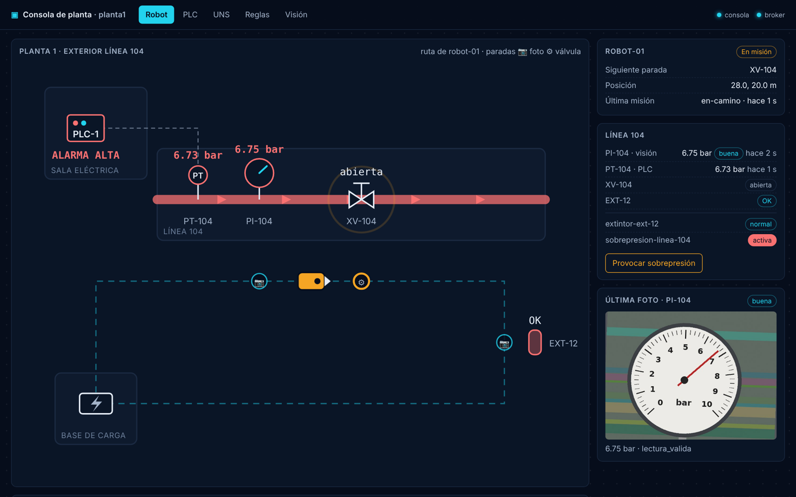
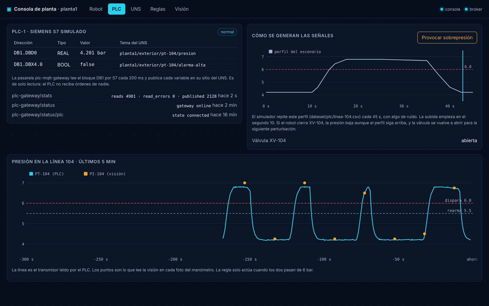
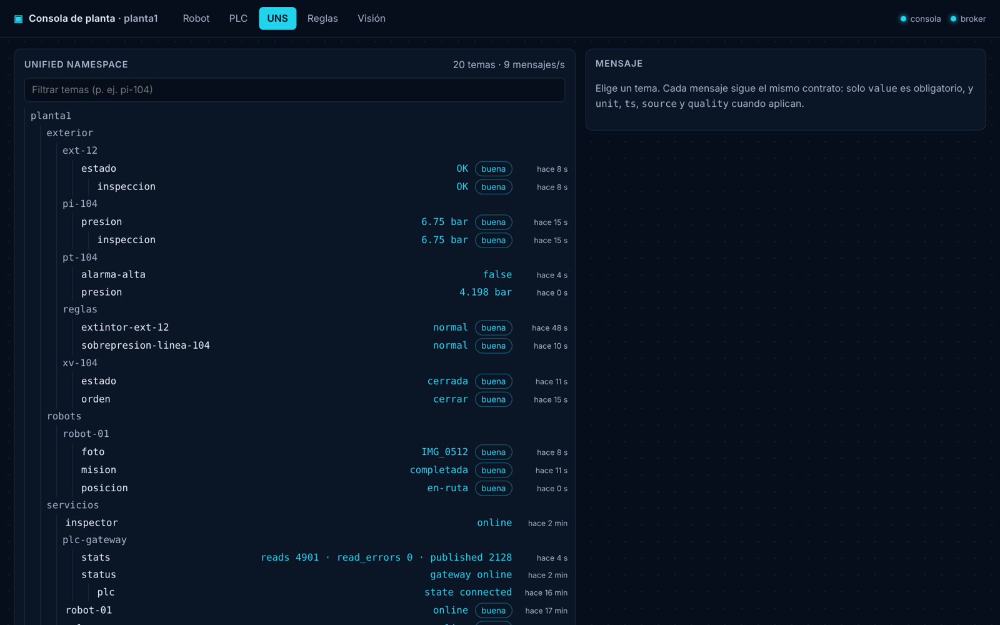
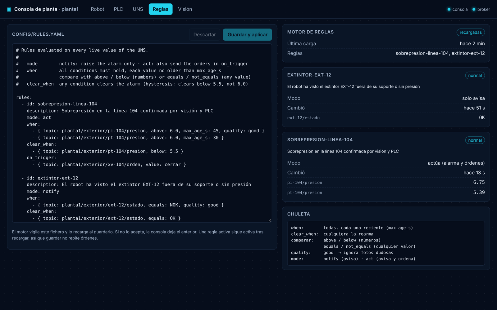
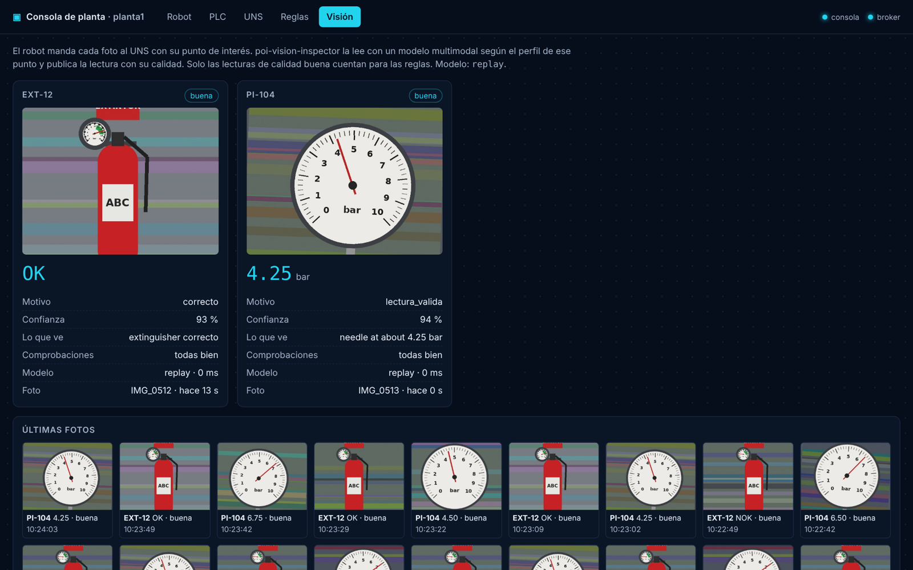

# Consola de planta

[](https://github.com/aseinotegi/plant-console/actions/workflows/ci.yml)


[English](README.md) · **Español**

La HMI de [industrial-uns-demo](https://github.com/aseinotegi/industrial-uns-demo): una consola web que muestra una planta **solo a través de su Unified Namespace**. El robot de inspección recorre su ruta sobre un mapa 2D, se para a fotografiar el manómetro y el extintor, y va a cerrar la válvula cuando las reglas se lo piden. Al lado están las señales del PLC, el namespace entero, las reglas (editables) y lo que el modelo de visión ha leído en cada foto.



Funciona como parte de la demo. Desde la carpeta de la demo:

```bash
docker compose up --build      # y abre http://localhost:8000
```

## Páginas

| Página | Qué enseña |
|---|---|
| **Robot** (inicio) | Mapa de la planta dibujado desde `config/planta.yaml`, el robot donde dice estar, valores de los instrumentos, estado de las reglas, última foto y un registro de lo que pasa. Un botón lanza una sobrepresión en el momento |
| **PLC** | Las variables S7 (DB1) y sus temas del UNS, el perfil del escenario que genera la señal y una tendencia de 5 minutos: el transmisor del PLC como línea y las lecturas de visión como puntos, con los umbrales de la regla |
| **UNS** | El namespace en árbol, con valor, calidad y antigüedad. Al pinchar un tema se ve el mensaje completo |
| **Reglas** | Editor de `rules.yaml`, el estado del motor y cada regla con las entradas que la decidieron |
| **Visión** | Última inspección de cada punto de interés (foto, valor, calidad, confianza, lo que vio el modelo, qué comprobaciones fallaron) y las últimas fotos |

| | |
|---|---|
|  |  |
|  |  |

## Cómo funciona

- **El UNS es la única fuente.** El backend se suscribe a `planta1/#` y guarda el último mensaje de cada tema, 15 minutos de tendencia de los numéricos y un registro de eventos. El navegador recibe todo al conectarse y luego cada mensaje nuevo, por un único WebSocket.
- **Los flujos no son eventos.** La posición del robot (5 por segundo) y la presión del PLC mueven la imagen pero no entran en el registro (`STREAM_TOPICS`). Los valores retenidos son estado: nunca cuentan como evento ni como punto de tendencia.
- **El único juez de las reglas es el motor.** La consola comprueba que el fichero es YAML con una lista `rules` y lo escribe. El motor lo recarga y contesta en `planta1/servicios/rules/config`. Si lo rechaza, la consola vuelve a poner el anterior, así que un fichero roto nunca se queda en disco para romper el siguiente arranque.
- **Solo lectura sobre la planta.** La consola no manda órdenes a los equipos. Lo único que puede cambiar en la simulación es lanzar una perturbación, que es un control del escenario y no una orden a la planta.
- **Un solo contenedor.** Vite construye la aplicación y FastAPI la sirve junto con la API. Sin librerías de gráficas ni de estado: una gráfica SVG pequeña y un store sobre `useSyncExternalStore`, que pinta como mucho una vez por fotograma.

La configuración (variables de entorno), el desarrollo en local y la estructura del código están en el [README en inglés](README.md#configuration).

## Licencia

MIT · [Ander Sein](https://andersein.com)
