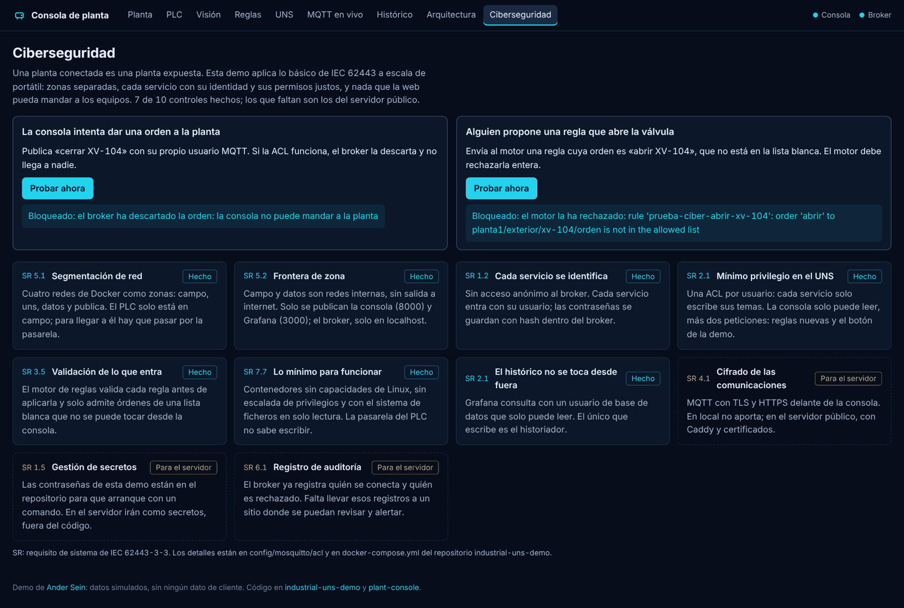

# Consola de planta

[](https://github.com/aseinotegi/plant-console/actions/workflows/ci.yml)


[English](README.md) · **Español**

La HMI de [industrial-uns-demo](https://github.com/aseinotegi/industrial-uns-demo): una consola web que muestra una planta **solo a través de su Unified Namespace**. Un robot de inspección recorre la planta sobre un plano 2D, se para a fotografiar manómetros y extintores y va a cerrar una válvula cuando las reglas se lo piden. Alrededor: las señales del PLC, lo que ha leído el modelo de visión en cada foto, un constructor de reglas, el namespace entero, el MQTT en directo, el histórico, la arquitectura y los controles de ciberseguridad, dos de ellos comprobables en directo.


Funciona como parte de la demo. Desde la carpeta de la demo:

```bash
docker compose up --build      # y abre http://localhost:8000
```

## Páginas

| Página | Qué enseña |
|---|---|
| **Planta** (inicio) | La planta dibujada desde el plano del propio robot: edificios, pasillos, tuberías con flujo, nivel del depósito, bomba en marcha y cada instrumento con su valor en vivo. El robot donde dice estar, con su rastro, su batería y lo que está mirando su cámara. Pulsando un equipo se ve su detalle y su última foto |
| **PLC** | Las nueve señales del DB1 con su tema del UNS, cómo genera el escenario las señales y tendencias de presión (PLC como línea, visión como puntos), caudal, nivel y corriente del motor |
| **Visión** | La última inspección de cada punto de la ronda: la foto real con su crédito, valor, calidad, confianza, lo que vio el modelo y qué comprobaciones fallaron |
| **Reglas** | Reglas como frases, montadas con las variables del UNS: *si* esto y esto, alarma (y una orden de la lista blanca del motor), *se rearma cuando* aquello. El motor valida y contesta |
| **UNS** | El namespace en árbol, con valor, calidad y antigüedad; cualquier mensaje completo |
| **MQTT en vivo** | Cada mensaje según llega al broker, con filtros, y las estadísticas del propio broker (`$SYS`) |
| **Histórico** | Grafana, dentro de la consola, leyendo TimescaleDB con un usuario de solo lectura |
| **Arquitectura** | Las redes como zonas y cada servicio con su estado en vivo |
| **Ciberseguridad** | Los controles de IEC 62443 hechos y pendientes, y dos pruebas en directo: la consola intenta dar una orden (el broker la descarta) y propone una regla que abre la válvula (el motor la rechaza) |

| | |
|---|---|
|  |  |
|  |  |
|  |  |

## Cómo funciona

- **El UNS es la única fuente.** El backend se suscribe a `planta1/#` y al `$SYS` del broker, y guarda el último mensaje de cada tema, 15 minutos de tendencia de los numéricos y un registro de eventos. El navegador lo recibe todo al conectarse y luego cada mensaje nuevo, por un único WebSocket, y pinta como mucho una vez por fotograma.
- **Solo puede leer.** Su usuario MQTT es de solo lectura, más dos peticiones que permite la ACL del broker: reglas nuevas y el botón de perturbación de la demo. No puede mandar una orden a la planta, y la página de Ciberseguridad lo demuestra contra el broker real.
- **Sin ficheros y sin simulador.** Las reglas van al motor por MQTT y el motor contesta; el plano y las fotos salen del servidor del propio robot. La consola nunca llega a la planta simulada ni a su PLC.
- **Un contenedor, de solo lectura.** Vite construye la aplicación y FastAPI la sirve junto con la API. Sin librerías de gráficas ni de estado: una gráfica SVG pequeña y un store sobre `useSyncExternalStore`.

El aspecto sigue la práctica de las HMI de alto rendimiento (ISA-101): la planta en grises tranquilos y color solo donde significa algo. Cian es dato en vivo, ámbar un aviso, rojo una alarma.

La configuración (variables de entorno), el desarrollo en local y la estructura del código están en el [README en inglés](README.md#configuration).

## Licencia

MIT · [Ander Sein](https://andersein.com). Las fotos reales que muestra vienen de Wikimedia Commons con su propia licencia, citada junto a cada una.
