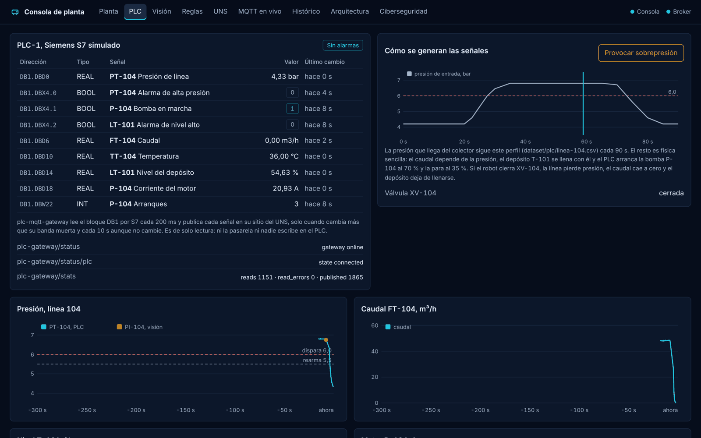
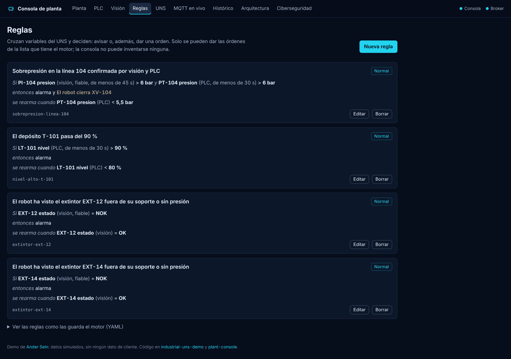
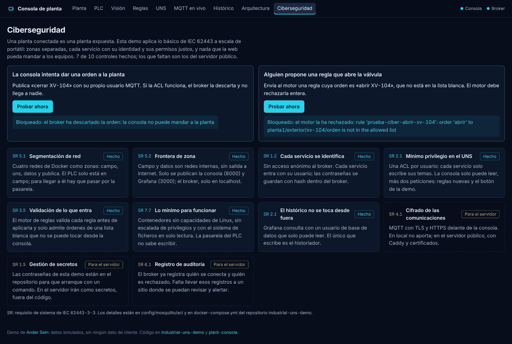
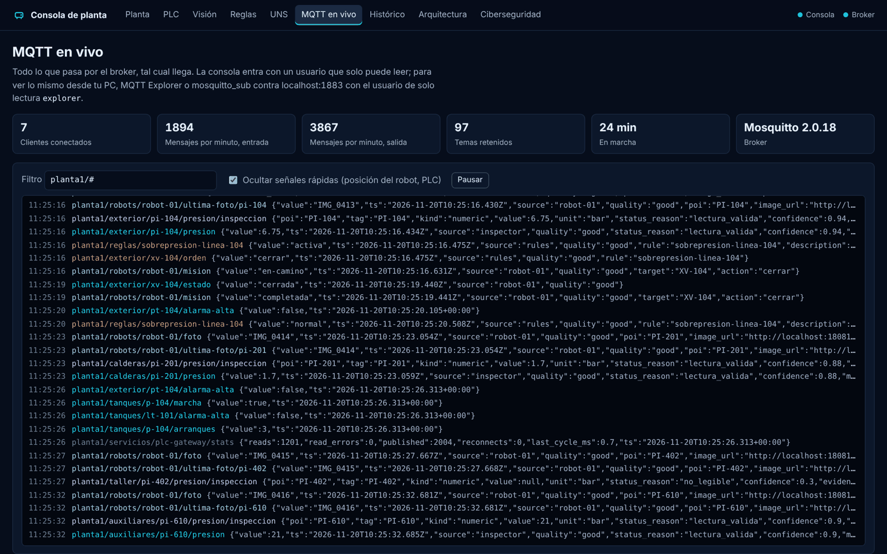
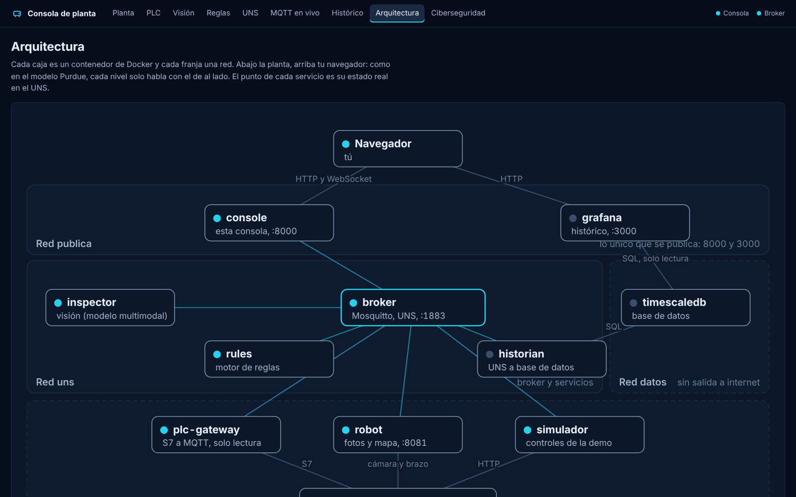
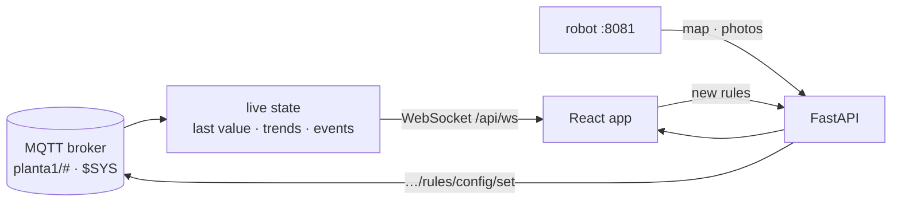

# Plant console

[](https://github.com/aseinotegi/plant-console/actions/workflows/ci.yml)


**English** · [Español](README.es.md)

The HMI of [industrial-uns-demo](https://github.com/aseinotegi/industrial-uns-demo): a web console that shows a plant **only through its Unified Namespace**. An inspection robot walks the plant on a 2D map, stops to photograph gauges and extinguishers and goes to close a valve when the rules ask it to. Around it: the PLC signals, what the vision model read in each photo, a rule builder, the whole namespace, a live MQTT view, the history, the architecture and the security controls, two of them testable live.


It runs as part of the demo. From the demo's folder:

```bash
docker compose up --build      # then open http://localhost:8000
```

## Pages

| Page | What it shows |
|---|---|
| **Planta** (home) | The plant drawn from the robot's own map: buildings, walkways, pipes with flow, tank level, pump running, every instrument with its live value. The robot where it says it is, with its trail, battery and what its camera is looking at. Click any equipment for its detail and last photo |
| **PLC** | The nine tags of DB1 with their UNS topics, how the scenario generates the signals, and trends of pressure (PLC line, vision dots), flow, level and motor current |
| **Visión** | The last inspection of each point of the round: the real photo with its credit, value, quality, confidence, what the model saw and which checks failed |
| **Reglas** | Rules as sentences, built from the variables of the UNS: *if* this and this, alarm (and an order from the engine's whitelist), *clears when* that. The engine validates and answers |
| **UNS** | The namespace as a tree, with value, quality and age; any message in full |
| **MQTT en vivo** | Every message as it reaches the broker, with filters, and the broker's own statistics (`$SYS`) |
| **Histórico** | Grafana, embedded, reading TimescaleDB with a read-only user |
| **Arquitectura** | Networks as zones and every service with its live status |
| **Ciberseguridad** | The IEC 62443 controls in place and pending, and two live checks: the console tries to send an order (the broker drops it) and proposes a rule that opens the valve (the engine refuses it) |

| | |
|---|---|
|  |  |
|  |  |
|  |  |

## How it works



- **The UNS is the only source.** The backend subscribes `planta1/#` and the broker's `$SYS`, and keeps the last message of each topic, a 15-minute trend of the numeric ones and a log of events. The browser gets all of it on connect and every new message after that, over one WebSocket, rendered at most once per frame.
- **It can only read.** Its MQTT user is read-only, plus two requests the broker's ACL allows: new rules and the demo's disturbance button. It cannot send an order to the plant, and the Ciberseguridad page proves it against the real broker.
- **No files, no simulator.** Rules go to the engine over MQTT and the engine answers; the map and the photos come from the robot's own server. The console never reaches the simulated plant or its PLC.
- **One container, read-only.** Vite builds the app and FastAPI serves it with the API. No chart or state library: a small SVG chart and a store on `useSyncExternalStore`.

The look follows high-performance HMI practice (ISA-101): the plant in quiet greys, colour only where it means something. Cyan is live, amber a warning, red an alarm.

## Configuration

Environment only:

| Variable | Default | |
|---|---|---|
| `MQTT_HOST`, `MQTT_PORT` | `localhost`, `1883` | broker |
| `MQTT_USERNAME`, `MQTT_PASSWORD` | none | its user on the broker |
| `SITE` | `planta1` | root of the namespace |
| `ROBOT_URL` | `http://localhost:8081` | the robot's server: map and photos |
| `GRAFANA_URL` | same host, port 3000 | Grafana as the browser reaches it |
| `STREAM_TOPICS` | robot position, fast PLC signals, `$SYS` | MQTT patterns kept out of the event log |
| `WEB_DIR`, `PORT` | set in the image | |

## Development

```bash
pip install -e ".[dev]"
pytest -q                                  # 20 tests, no broker needed
MQTT_USERNAME=console MQTT_PASSWORD=demo-console plant-console

cd web && npm install && npm run dev       # http://localhost:5173, /api goes to :8000
```

```text
src/plant_console/
  live.py        UNS → last value per topic, trends, event log, listeners
  app.py         HTTP + WebSocket API, rules and checks through the UNS, serves the web app
web/src/
  live.ts        the WebSocket store
  components/    PlantMap (SVG in metres), Chart, Photo, cards
  pages/         Planta, PLC, Visión, Reglas, UNS, MQTT, Histórico, Arquitectura, Ciberseguridad
```

## License

MIT · [Ander Sein](https://andersein.com). The real photos shown come from Wikimedia Commons with their own licences, credited next to each one.
