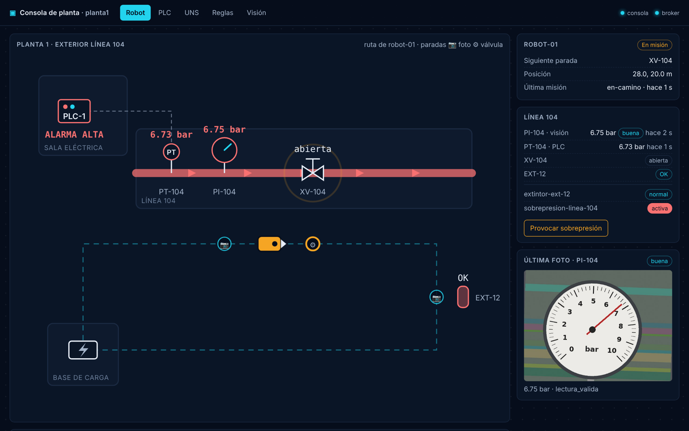
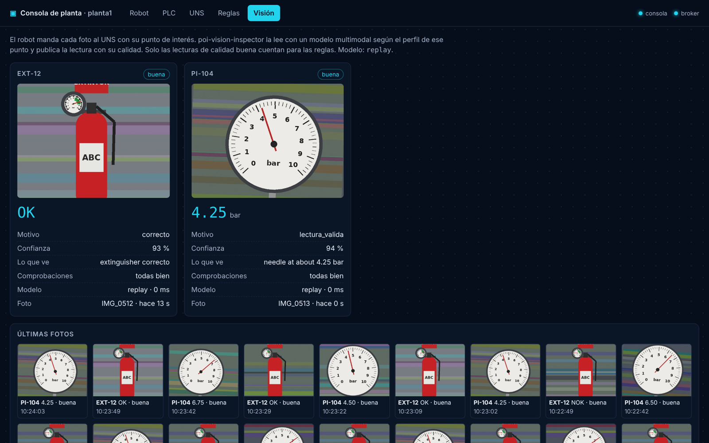
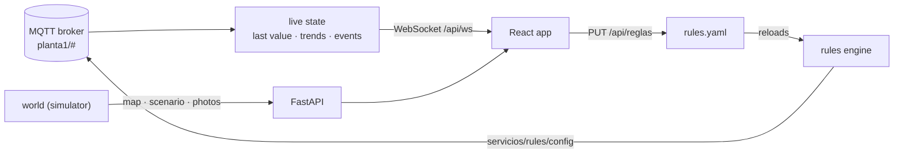

# Plant console

[](https://github.com/aseinotegi/plant-console/actions/workflows/ci.yml)


**English** · [Español](README.es.md)

The HMI of [industrial-uns-demo](https://github.com/aseinotegi/industrial-uns-demo): a web console that shows a plant **only through its Unified Namespace**. The inspection robot walks its route on a 2D map, stops to photograph the gauge and the extinguisher, and goes to close the valve when the rules ask it to. Next to it are the PLC signals, the whole namespace, the rules (editable) and what the vision model read in every photo.



It runs as part of the demo. From the demo's folder:

```bash
docker compose up --build      # then open http://localhost:8000
```

## Pages

| Page | What it shows |
|---|---|
| **Robot** (home) | Plant map drawn from `config/planta.yaml`, the robot where it says it is, live instrument values, rule states, last photo and a log of what is happening. A button starts an overpressure now |
| **PLC** | The S7 tags (DB1) and their UNS topics, the scenario profile that generates the signal and a 5-minute trend: PLC transmitter as a line, vision readings as dots, with the rule thresholds |
| **UNS** | The namespace as a tree, with value, quality and age. Click a topic to see the full message |
| **Reglas** | Editor for `rules.yaml`, the engine status and every rule with the inputs that decided it |
| **Visión** | Last inspection per point of interest (photo, value, quality, confidence, what the model saw, which checks failed) and the latest photos |

| | |
|---|---|
|  |  |
|  |  |

## How it works



- **The UNS is the only source.** The backend subscribes `planta1/#` and keeps the last message of each topic, a 15-minute trend of the numeric ones and a log of events. The browser gets all of it on connect and every new message after that, over one WebSocket.
- **Streams are not events.** The robot's position (5 per second) and the PLC pressure move the picture but stay out of the log (`STREAM_TOPICS`). Retained values are state, so they never count as events or trend points.
- **The rules engine is the only judge of the rules.** The console checks that the file is YAML with a `rules` list and writes it. The engine reloads it and answers on `planta1/servicios/rules/config`. If it refuses the file, the console puts the previous one back, so a broken file never stays on disk to break the next start.
- **Read-only on the plant.** The console sends no orders to devices. The only thing it can change in the simulation is starting a disturbance, which is a scenario control and not a plant command.
- **One container.** Vite builds the app, FastAPI serves it with the API. No chart or state library: a small SVG chart and a store on `useSyncExternalStore`, rendered at most once per frame.

## Configuration

Environment only:

| Variable | Default | |
|---|---|---|
| `MQTT_HOST`, `MQTT_PORT` | `localhost`, `1883` | broker |
| `SITE` | `planta1` | root of the namespace |
| `WORLD_URL` | `http://localhost:8080` | simulator: map, scenario and photos |
| `RULES_FILE` | none | rules file to edit. Without it the Reglas page is read-only |
| `STREAM_TOPICS` | robot position, PT-104 | comma-separated MQTT patterns kept out of the event log |
| `WEB_DIR`, `PORT` | set in the image | |

## Development

```bash
pip install -e ".[dev]"
pytest -q                                  # 15 tests, no broker needed
MQTT_PORT=1883 WORLD_URL=http://localhost:8080 RULES_FILE=../industrial-uns-demo/config/rules.yaml plant-console

cd web && npm install && npm run dev       # http://localhost:5173, /api goes to :8000
```

```text
src/plant_console/
  live.py        UNS → last value per topic, trends, event log, listeners
  rules_file.py  write the rules, wait for the engine, roll back if refused
  app.py         HTTP + WebSocket API, serves the web app
web/src/
  live.ts        the WebSocket store
  components/    PlantMap (SVG in metres), Chart, cards
  pages/         Robot, PLC, UNS, Reglas, Visión
```

## License

MIT · [Ander Sein](https://andersein.com)
